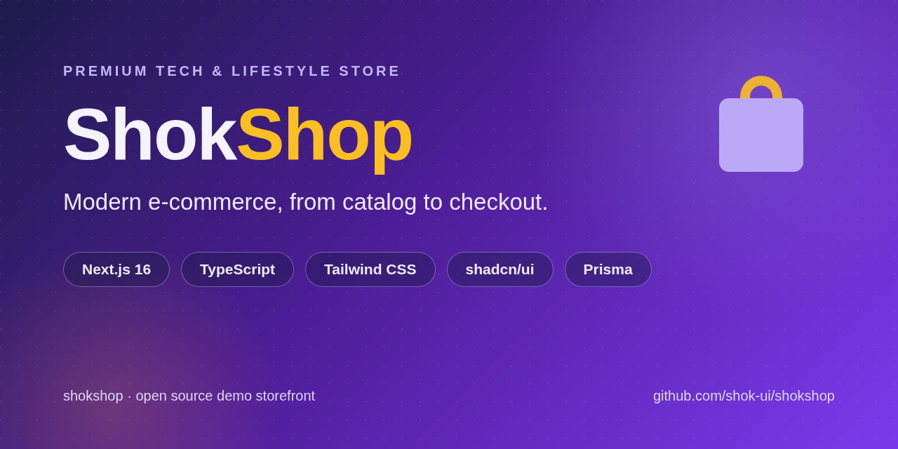
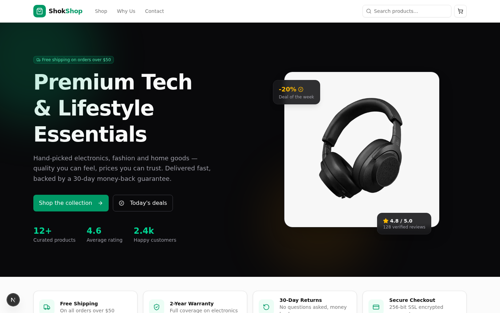
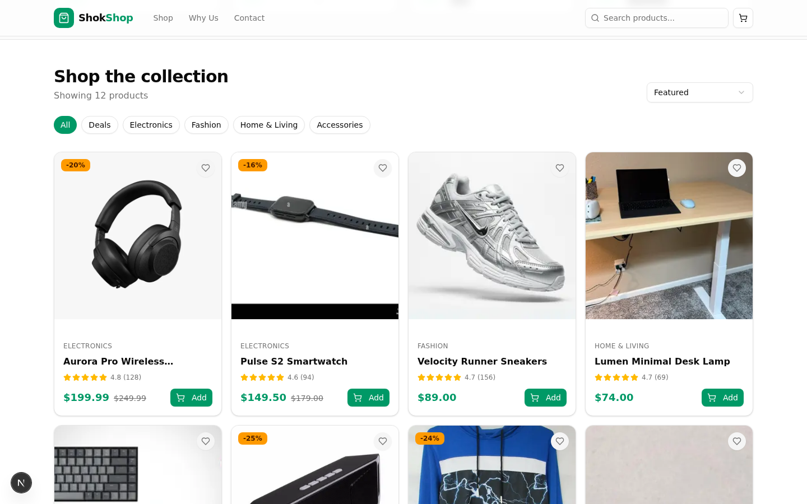
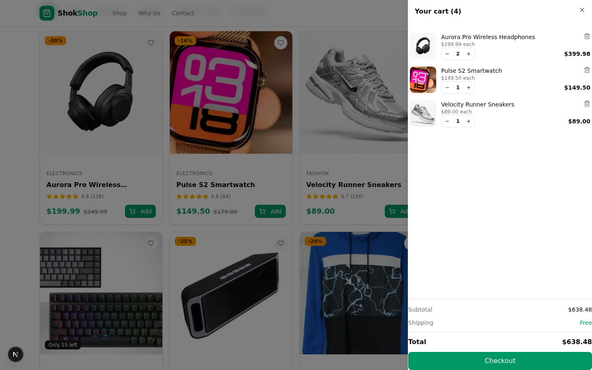
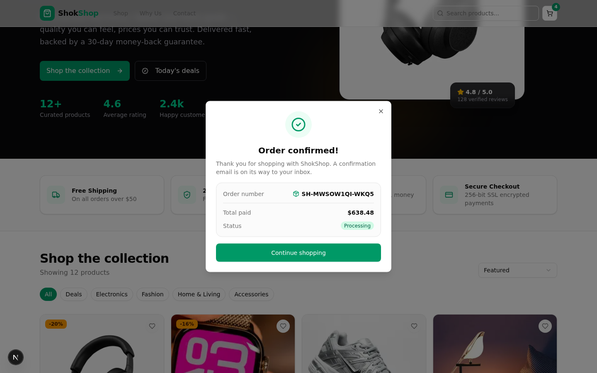

# ShokShop — Premium Tech & Lifestyle Store



A modern, production-style e-commerce web application built with **Next.js 16 (App Router)**, **TypeScript**, **Tailwind CSS 4**, **shadcn/ui** and **Prisma (SQLite)**.


## Screenshots

| Hero | Catalog |
| --- | --- |
|  |  |

| Cart | Order confirmation |
| --- | --- |
|  |  |

## Features

- **Product catalog** — 12 curated products across Electronics, Fashion, Home & Living and Accessories, served from a real database through a REST API.
- **Search, filter & sort** — instant text search, category chips (including a "Deals" view for discounted items) and sorting by price, rating or review count.
- **Product detail dialog** — full description, feature list, star ratings, stock status and a quantity stepper.
- **Shopping cart** — persistent cart (Zustand + localStorage) with quantity steppers, free-shipping progress bar ($50 threshold) and live totals.
- **Checkout flow** — validated shipping form (React Hook Form + Zod), three payment methods (Cash on Delivery, Credit/Debit Card with demo card validation, Bank Transfer) and real order persistence.
- **Order confirmation** — generated order number, stored order and stock decrement on purchase.
- **Wishlist** — one-click product favoriting with toast feedback.
- **Newsletter section** — email capture UI with validation.
- **Responsive design** — mobile-first layout, sticky header, mobile navigation sheet, sticky footer.
- **Toast notifications** — user feedback for cart, wishlist and newsletter actions.

## Tech Stack

| Layer | Technology |
| --- | --- |
| Framework | Next.js 16 (App Router, Turbopack), React 19 |
| Language | TypeScript 5 |
| UI | Tailwind CSS 4, shadcn/ui, Lucide icons, Framer Motion |
| State | Zustand (persistent cart & wishlist) |
| Backend | Next.js Route Handlers (REST API) |
| Database | SQLite via Prisma ORM |
| Validation | Zod (shared client/server schemas) |
| Forms | React Hook Form |

## Getting Started

### Prerequisites

- Node.js 18+ (or [Bun](https://bun.sh) 1.1+)
- npm / pnpm / bun package manager

### Installation

```bash
# 1. Install dependencies
npm install        # or: bun install

# 2. Configure the environment
mkdir -p db
cp .env.example .env

# 3. Create the database and push the schema
npm run db:push    # or: bun run db:push

# 4. Seed the database with 12 demo products
npx tsx prisma/seed.ts    # or: bun prisma/seed.ts

# 5. Start the development server
npm run dev        # or: bun run dev
```

Open [http://localhost:3000](http://localhost:3000) in your browser.

> The database file is created at `db/custom.db` (configured through `DATABASE_URL` in `.env`).

### Environment Variables

Create a `.env` file in the project root:

```env
DATABASE_URL="file:../db/custom.db"
```

## Project Structure

```
├── prisma/
│   ├── schema.prisma        # Product & Order models
│   └── seed.ts              # Demo data seeder
├── src/
│   ├── app/
│   │   ├── api/
│   │   │   ├── products/route.ts   # GET /api/products
│   │   │   └── orders/route.ts     # POST /api/orders
│   │   ├── layout.tsx
│   │   └── page.tsx         # Store entry page
│   ├── components/
│   │   ├── ui/              # shadcn/ui components
│   │   └── store/           # Store UI (header, hero, catalog, cart, checkout...)
│   ├── hooks/               # use-toast, use-mobile
│   └── lib/                 # db client, cart store, shared types
├── docs/screenshots/        # README screenshots
└── db/                      # SQLite database (generated)
```

## API Reference

| Method | Endpoint | Description |
| --- | --- | --- |
| `GET` | `/api/products` | List all products (ordered by id) |
| `POST` | `/api/orders` | Create an order. Body: customer info + items + totals. Validates with Zod, generates an order number and decrements product stock |

## Available Scripts

| Command | Description |
| --- | --- |
| `npm run dev` | Start the dev server on port 3000 |
| `npm run build` | Production build |
| `npm run start` | Start the production server |
| `npm run lint` | Run ESLint |
| `npm run db:push` | Push the Prisma schema to SQLite |
| `npm run db:generate` | Generate the Prisma Client |

## Notes

- This is a **demo store**: no real payment gateway is connected. Card fields are validated client-side but nothing is charged.
- Orders, products and stock are stored in a real SQLite database, so the data persists across restarts.
- For production deployment on Vercel, swap SQLite for PostgreSQL/MySQL by changing the Prisma datasource provider.

## License

Released under the [MIT License](LICENSE).
